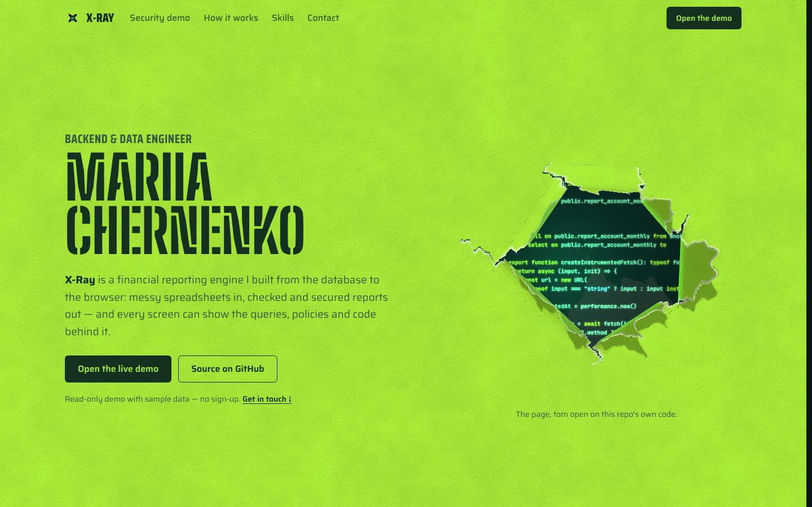
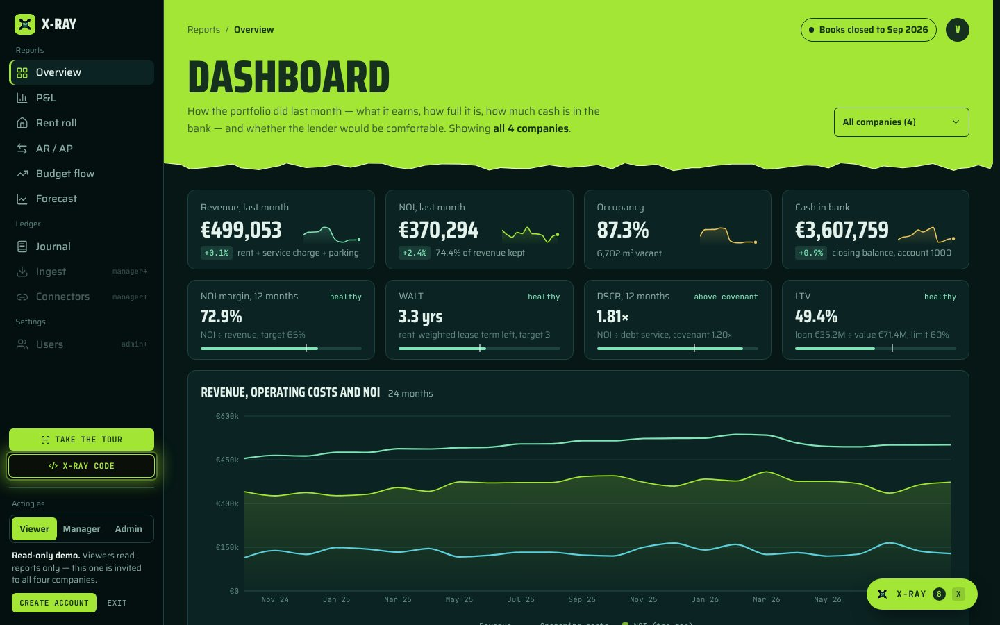
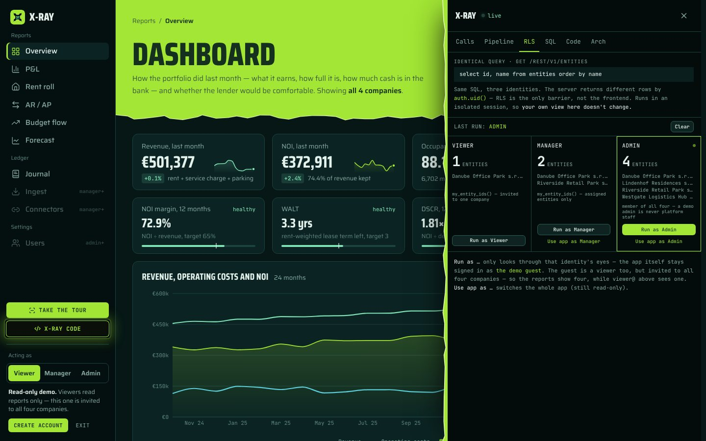
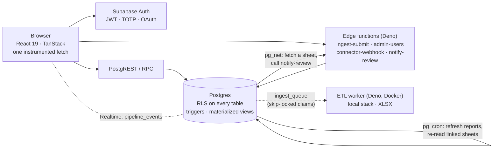

# X-Ray Financial Reporting Engine

[](https://github.com/ria631/rievoree_ukazka/actions/workflows/ci.yml)

A full-stack financial reporting tool whose real product is **visible backend
machinery**: every page carries an X-ray panel that shows the live API calls,
RLS policies, SQL and security layers doing the work.

**Live demo:** https://rievoree-ukazka.vercel.app — click **Explore the demo**
(read-only, no account), then press **X** (or the lime X-RAY pill) on any page.

Portfolio project by **Mariia Chernenko**. All data is fake, built from scratch.



| The books of a four-building property group | X-ray → RLS: the same query as three people |
|---|---|
|  |  |

### Five minutes, if you're reviewing
1. **Explore the demo** → Dashboard. Every figure is a query result, RLS-scoped.
2. Press **X** → **RLS** → *Run as* Viewer / Manager / Admin: Postgres returns
   1 / 2 / 4 companies for the identical `select` (real sign-ins, isolated session).
3. **Calls** — every request the page made, timed at one fetch seam
   ([`instrumentedFetch.ts`](src/lib/xray/instrumentedFetch.ts)).
4. **X-ray code** (sidebar) → click any chart: an editor opens on the exact lines
   that draw it, the component and the SQL/maths behind it.
5. Switch to **Manager** in the sidebar → **Ingest**: a batch held by the z-score
   screen, and why ([`detect_anomalies`](supabase/tests/detect_anomalies_test.sql)).
6. Skim [`supabase/migrations/`](supabase/migrations) and
   [`supabase/tests/`](supabase/tests): 45 migrations, 98 pgTAP assertions —
   plus 81 vitest tests for the reporting maths and 14 Deno tests for the parser.

## Architecture



The hosted demo parses CSV in the browser and validates, screens and loads in
Postgres; the Docker worker (dotted) is the XLSX path in the local stack.

---

## What it actually does

Messy accounting spreadsheets in → validated, anomaly-screened, RLS-scoped
reports out — and you can watch every layer run:

- **Multi-tenant RLS.** The same query returns different rows per role; the
  database, not the frontend, is the barrier. The X-ray **RLS** tab runs the
  identical `select … from entities` as viewer / manager / admin and shows the
  row counts side by side.
- **Real ETL pipeline.** Upload a CSV → validate per-entity rules → z-score
  anomaly screen → manual approval → idempotent delete-and-reload → the report
  materialized view refreshes (trigger chain + `pg_cron`), with `pg_net` calling
  an edge function on the way.
- **Auth & user management.** Four roles, TOTP 2FA, email invites, password
  reset, deactivation, OAuth — with frozen privileged columns (defense in depth).
- **Connectors.** A spreadsheet link (a Google Sheet shared "anyone with the
  link", or any public CSV) that the database itself fetches with `pg_net`,
  parses in SQL and re-reads hourly via `pg_cron` — plus an HMAC-signed
  webhook. Both feed the same pipeline; already-seen content is skipped.

### What's real vs. illustrative (honesty invariant)
Every figure in the product app is a real query result. On the landing, the
code in the hero animation is **pulled from the repo files at build time**
(`src/pages/landing/repoSource.ts`, Vite `?raw`), never retyped. The MCP and
migration sections are **animations** of the kind of system I build, labelled
as such. The live role check is the X-ray **RLS** tab, which runs the query
against Postgres as each role. The X-ray **SQL** tab shows
reference SQL pulled from the migrations, clearly marked "not a live EXPLAIN";
the **Calls** and **Pipeline** tabs are live.

---

## Repository map

| Path | Responsibility |
|---|---|
| `src/` | React 19 + TypeScript frontend (Vite, Tailwind v4, shadcn/ui, TanStack Router/Query, recharts) |
| `src/lib/xray/` | X-ray instrumentation: every Supabase request is timed at the fetch layer |
| `supabase/migrations/` | Versioned SQL — schema, RLS policies, RPCs, grant hardening |
| `supabase/tests/` | pgTAP: ETL transform, z-score, load, tenant isolation, demo lockdown and privacy |
| `supabase/functions/` | Deno edge functions (ingest-submit, notify-review, connectors, admin-users) |
| `worker/` | Deno ETL worker — used locally for XLSX; the hosted path parses CSV in-browser |
| `docs/` | [`OPERATIONS.md`](docs/OPERATIONS.md) (deploy, the shared demo, smoke tests), README images |
| `design/` | HTML mockups of the brand: landing, app shell, the mark |

## Security model

- **Multi-tenant RLS** on every table, keyed by `entities`; global roles
  (super_admin / admin / manager / viewer) + per-entity membership.
- **Global admin is explicit.** Cross-tenant access requires
  `profiles.is_platform_staff`; a self-registered admin is scoped to their own
  entities. (This closed a privilege-escalation found in review — see
  migration `20261013000001`.)
- **Demo accounts are DB-locked read-only** (`profiles.is_demo`): they can't
  change role/password/2FA, provision, or manage connectors/members, and an
  hourly `reset_demo_state()` keeps the showcase clean. Their password is
  public, so a demo identity only ever lists other demo identities — never a
  real account that joined a sample company (migration `20261121000001`, test
  `demo_members_privacy_test.sql`).
- **Defense in depth:** column-level grants under RLS under triggers — frozen
  profile columns are protected at three layers.
- **Least privilege:** API roles hold only what they can legitimately use;
  `ingest_queue` is deny-all by design.
- **Headers on deploy** (`vercel.json`): a CSP limited to the app, Google Fonts
  and Supabase (`wasm-unsafe-eval` only for the code highlighter),
  `frame-ancestors 'none'`, `nosniff`, a strict referrer and permissions policy.

## How it was built

Designed and built by Mariia Chernenko between June and November 2026, with
**Claude Code as a pair programmer** — most commits carry its `Co-Authored-By`
trailer, and that's deliberate rather than hidden. The working method, visible
in the history:

- **Database first, tests with it.** Security-relevant changes ship with a
  pgTAP test that fails without them (the demo-privacy test fails on the
  previous `list_org_members`); CI runs them against a real Supabase stack.
  The reporting maths has its own unit tests — writing them turned up four
  real bugs (a decimal comma read as ×100, an opening balance dropped, signed
  leases ignored by the forecast, days-to-pay biased low), all fixed.
- **Review finds real bugs.** A privilege escalation (a self-registered admin
  reaching other tenants) was caught in review and closed in
  `20261013000001`, with a regression test; a later client-perspective review
  found the demo admin could list real accounts — fixed in `20261121000001`.
- **Honesty as an invariant.** Every figure in the app is a query result;
  anything illustrative says so; the code the landing and the X-ray show is
  read from the repo at build time, never retyped.
- **Design as files.** The brand mockups the UI is built from live in
  [`design/`](design).

## Getting started (local)

Prerequisites: Node 20+, Docker, [Supabase CLI](https://supabase.com/docs/guides/local-development) (CI pins 3.2.0).

```bash
npm install
# config.toml reads OAuth provider secrets from env — dummy values are fine locally:
export SUPABASE_AUTH_EXTERNAL_GOOGLE_CLIENT_ID=x SUPABASE_AUTH_EXTERNAL_GOOGLE_SECRET=x \
       SUPABASE_AUTH_EXTERNAL_GITHUB_CLIENT_ID=x SUPABASE_AUTH_EXTERNAL_GITHUB_SECRET=x
supabase start            # boots the local stack + applies all migrations + seed
cp .env.example .env.local
# fill VITE_SUPABASE_URL + VITE_SUPABASE_ANON_KEY from `supabase status`
npm run dev
```

All demo users share the password **`demo123456`** (local seed, `super@` /
`admin@` / `manager@` / `viewer@` / `demo@demo.local`). The shared accounts are
read-only — register a real account to try uploads and role switching.

## Tests

```bash
supabase test db          # pgTAP (98): transform, z-score, load, tenant isolation, demo lockdown
cd worker && deno test    # 14 tests: CSV/XLSX parser + CSV-injection sanitizer
npm test                  # 81 vitest tests: KPIs, rent roll, aging, cash, forecast, CSV
npm run lint              # ESLint
npm run build             # tsc -b (typecheck) + vite build
bash scripts/check-migrations.sh   # migration-safety scanner (no fake-RLS)
```

CI (`.github/workflows/ci.yml`) runs all of the above on every push and PR.

## Scripts

| Command | What it does |
|---|---|
| `npm run dev` | Vite dev server |
| `npm run build` | typecheck + production build |
| `npm run typecheck` | `tsc -b` |
| `npm run stack` | Supabase stack + worker container + Vite |
